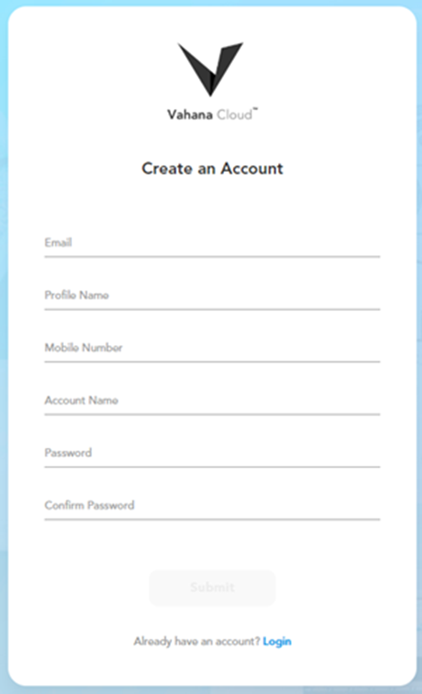

# Registering with Vahana Portal
To access the Vahana platform, you need to become registered user on the Vahana platform. To register on the Vahana platform.
1. Open the Internet browser.
2. In the address box, enter the URL of Vahana portal and then press **Enter** to display the Vahana portal's login page. 
3. On the login page, click the **Sign Up** link to display the registration page.
4. On the registration page, enter the details in the following boxes:
   * **Email**
   * **Profile Name** 
   * **Mobile Number**
   * **Account Name (For example:- Peter Dsouza)**
   * **Password (In this box, enter the password that you use to access the Vahana platform)**
   * **Confirm Password (In this box, reenter the password that you have entered in the Password box)**

   

> **Note:-**  After you become registered user on Vahana, the email ID that you enter on the registration page is treated as your registered login ID.

After you become a registered user on the Vahana platform, it automatically creates a unique org ID (organization ID) and then assigns it to your Vahana user account. Later, when you access Vahana, it authorizes your login request by validating org ID.

